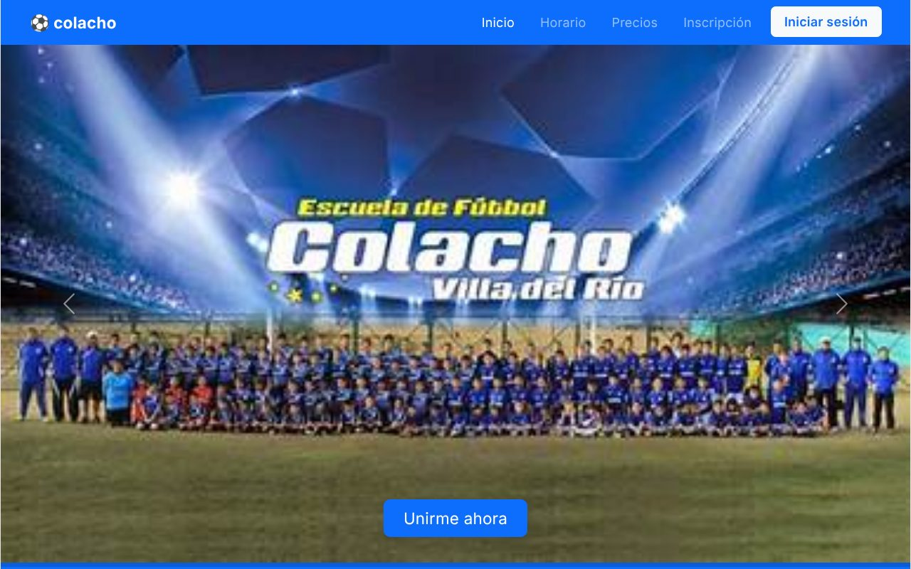
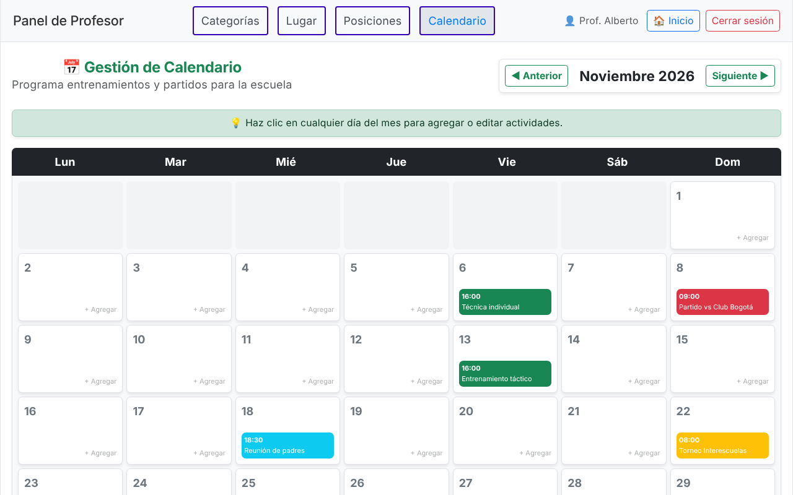
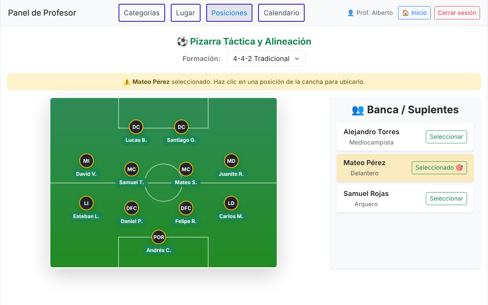
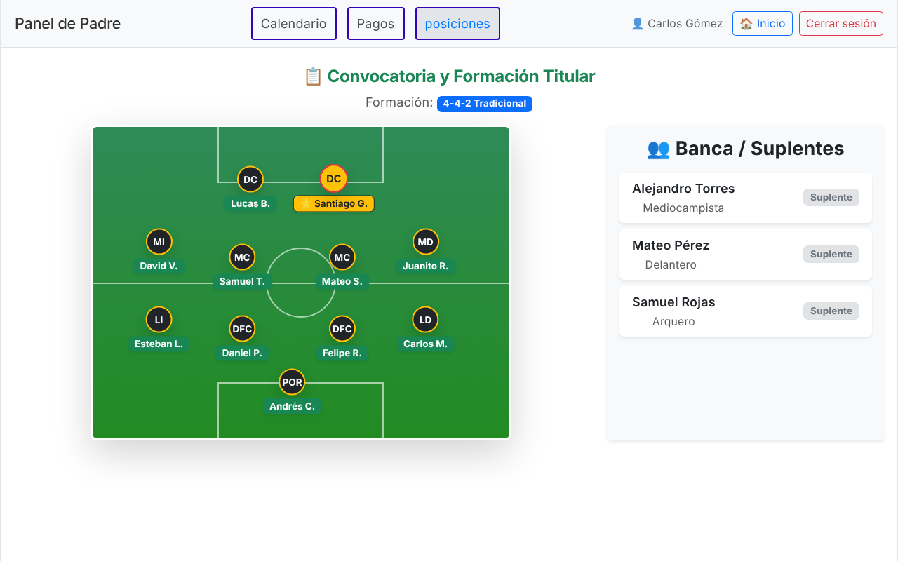
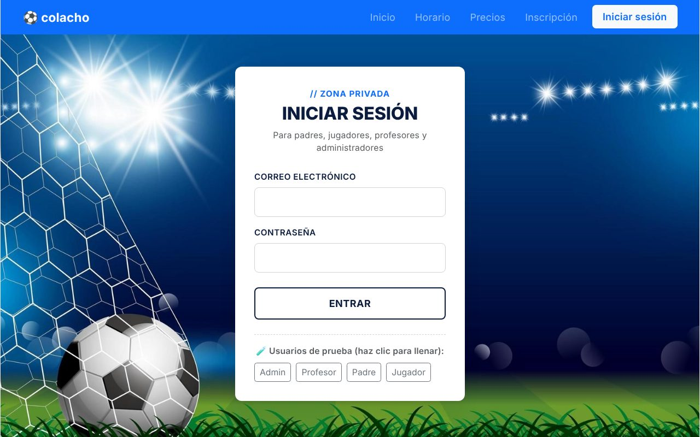

# ⚽ Escuela de Fútbol Colacho

Plataforma web para una escuela de fútbol infantil de Villa del Río: una **página pública** para atraer nuevas familias y una **zona privada con 4 paneles** (administrador, profesor, padre y jugador), cada uno con sus propias funciones.

🔗 **Demo en vivo:** [escuela-ten-omega.vercel.app](https://escuela-ten-omega.vercel.app)

> 🧪 **Proyecto en desarrollo.** El frontend está completo; el backend (API + base de datos) es la siguiente etapa. Mientras tanto, los datos se guardan en el navegador (`localStorage`) y el inicio de sesión usa usuarios de prueba.



---

## 🔑 Pruébalo

Entra a [/login](https://escuela-ten-omega.vercel.app/login) y usa los botones de **usuarios de prueba**, o escribe:

| Rol | Correo | Contraseña |
|---|---|---|
| Administrador | `admin@colacho.com` | `admin123` |
| Profesor | `profe@colacho.com` | `profe123` |
| Padre | `padre@colacho.com` | `padre123` |
| Jugador | `jugador@colacho.com` | `jugador123` |

💡 **Prueba esto:** entra como **profesor**, arma una alineación en *Posiciones* y programa un partido en *Calendario*. Luego cierra sesión, entra como **padre** y verás esos mismos cambios, con su hijo destacado con ⭐ en la cancha.

---

## ✨ Funcionalidades

### Página pública
- Inicio con carrusel, beneficios del fútbol y zona para padres
- Horarios y precios
- Formulario de inscripción con validación (React Hook Form + Zod)
- Contacto directo por WhatsApp
- Diseño adaptable a celular, con menú hamburguesa

### Zona privada (según el rol)
| Rol | Qué puede hacer |
|---|---|
| 👨‍💼 **Administrador** | Gestionar inscripciones, categorías, usuarios y pagos |
| 👨‍🏫 **Profesor** | Gestionar el calendario de actividades, armar la alineación en la pizarra táctica y ver sus categorías |
| 👨‍👩‍👦 **Padre** | Ver el calendario, los pagos y la alineación (su hijo aparece destacado) |
| ⚽ **Jugador** | Ver el calendario y la alineación del próximo partido |

- **Rutas protegidas:** sin sesión, los paneles redirigen al login; y cada rol solo puede entrar a su propio panel.
- **La sesión se mantiene** al recargar la página.

---

## 📸 Capturas

| Calendario (profesor) | Pizarra táctica (profesor) |
|---|---|
|  |  |

| Alineación vista por un padre | Inicio de sesión |
|---|---|
|  |  |

<p align="center">
  
  <br><em>Vista en celular</em>
</p>

---

## 🛠️ Tecnologías

- **React 19** + **TypeScript**
- **Vite** (entorno de desarrollo y compilación)
- **React Router** (navegación y rutas protegidas)
- **React Hook Form** + **Zod** (formularios y validación)
- **Bootstrap 5** + CSS propio
- **Context API** (manejo de la sesión)
- **ESLint** (calidad de código)
- Publicado en **Vercel**

---

## 🧠 Decisiones técnicas

- **Componentes compartidos con props:** el calendario y la pizarra táctica son un solo componente que se usa en varios paneles. La prop `editable` decide si se puede modificar (profesor) o solo ver (padres y jugadores).
- **Sesión con Context:** un `AuthProvider` comparte el usuario con toda la aplicación, y el hook `useAuth()` permite usarlo desde cualquier componente sin pasar props por varios niveles.
- **Rutas protegidas:** el componente `RutaProtegida` revisa la sesión y el rol antes de mostrar cada panel.
- **Lógica separada de la vista:** las funciones que guardan y leen datos están en archivos aparte (`calendarioUtils.ts`, `pizarraUtils.ts`). Al conectar el backend, solo cambian esas funciones; los componentes quedan igual.
- **Datos normalizados:** la alineación guarda solo los **id** de los jugadores, igual que se hará en la base de datos.

---

## 📁 Estructura

```
src/
├── auth/           # Sesión: usuarios de prueba, contexto y rutas protegidas
├── components/
│   ├── compartidos/   # Calendario, pizarra táctica, categorías, botones de sesión
│   ├── admin/         # Panel del administrador
│   ├── profesores/    # Panel del profesor
│   ├── padres/        # Panel del padre
│   ├── jugadores/     # Panel del jugador
│   └── ...            # Navbar, footer, carrusel, formularios...
├── config/         # Datos de contacto
├── hooks/          # Hooks reutilizables
├── layouts/        # Plantilla de las páginas públicas
└── pages/          # Páginas: inicio, login, 404
```

---

## 🚀 Ejecutar en tu computador

Necesitas [Node.js](https://nodejs.org) 22 o superior.

```bash
git clone https://github.com/carlosgomez2654/escuela.git
cd escuela
npm install
npm run dev
```

Abre `http://localhost:5173` en el navegador.

| Comando | Qué hace |
|---|---|
| `npm run dev` | Inicia el servidor de desarrollo |
| `npm run build` | Compila el proyecto para producción |
| `npm run lint` | Revisa la calidad del código |
| `npm run preview` | Muestra localmente la versión compilada |

---

## 🗺️ Próximos pasos

- [ ] Backend con **Node.js + Express**
- [ ] Base de datos **PostgreSQL** (usuarios, jugadores, categorías, pagos, eventos)
- [ ] Inicio de sesión real con contraseñas cifradas y tokens
- [ ] Conectar el frontend con la API
- [ ] Fotos reales de la escuela en el carrusel

---

## 👤 Autor

**Carlos Gómez** · [GitHub](https://github.com/carlosgomez2654)

